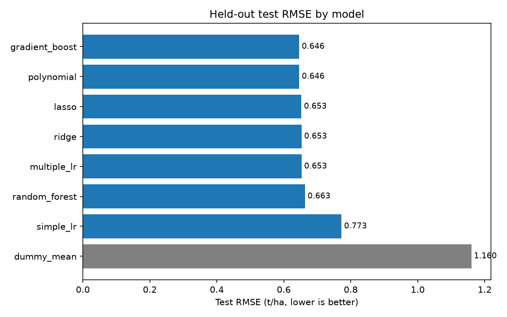
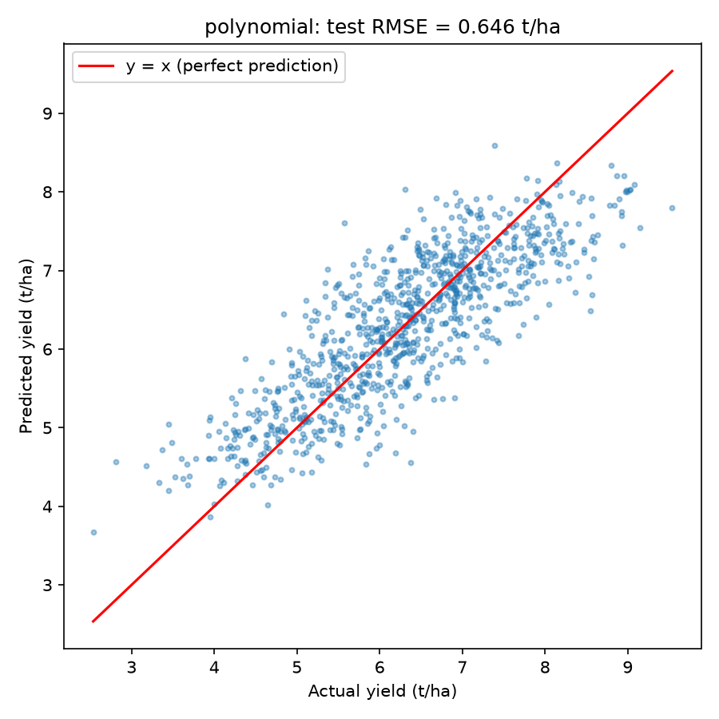
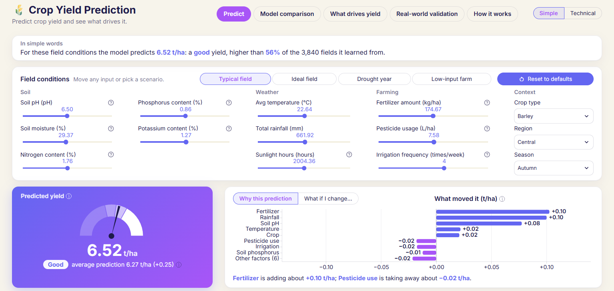
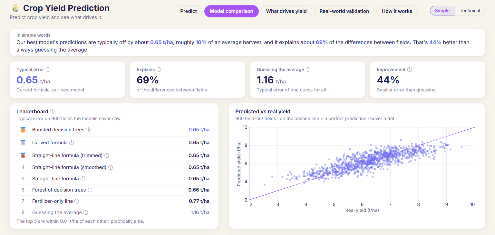
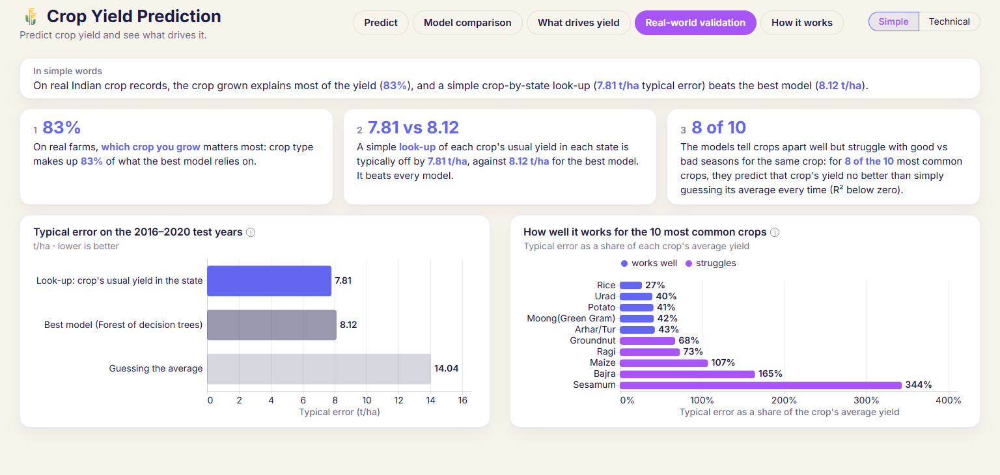

# 🌾 Crop Yield Prediction Using Machine Learning

**Predicting agricultural crop yield (tons/hectare) from soil, weather and farming parameters, and testing whether the findings hold on real Indian government data.**

---

## Table of Contents

1. [What this project is about](#1-what-this-project-is-about)
2. [Key findings at a glance](#2-key-findings-at-a-glance)
3. [Research questions](#3-research-questions)
4. [Datasets](#4-datasets)
5. [Methodology](#5-methodology)
6. [Results in detail](#6-results-in-detail)
7. [The interactive demo app](#7-the-interactive-demo-app)
8. [Project structure](#8-project-structure)
9. [How to reproduce everything](#9-how-to-reproduce-everything)
10. [Verification and reproducibility](#10-verification-and-reproducibility)
11. [Limitations](#11-limitations)
12. [Further documentation](#12-further-documentation)

---

## 1. What this project is about

Farmers, agronomists and policy-makers want to know how much a field will produce before harvest and which factors matter most for that output. This project treats that as a **supervised regression problem**: given measurements of soil, weather and farming practices, predict crop yield in tons per hectare.

The project goes beyond fitting one model. It:

- **Compares eight models of increasing flexibility**, from a baseline that always predicts the average, through simple, multiple, polynomial, Ridge and Lasso regression, up to Random Forest and XGBoost. This shows how much accuracy each step in complexity actually buys.
- **Runs full statistical diagnostics** (multicollinearity, residual normality, heteroscedasticity, coefficient significance) instead of reporting a single accuracy score.
- **Explains the models** with four independent importance methods (standardized coefficients, Lasso selection, permutation importance and SHAP) and checks whether they agree.
- **Tests the conclusions on real data.** The primary Kaggle dataset turned out to be synthetic, so every finding is re-tested on 24 years of real Indian state-level crop data, with a time-based split that simulates forecasting future years.
- **Ships an interactive Streamlit app** where you can move sliders for each input and see the predicted yield and a per-feature explanation update live.

```
 Soil     (pH, moisture, N, P, K)      ─┐
 Weather  (rainfall, temp, sunlight)   ─┤
 Farming  (fertilizer, pesticide,       ├─► Preprocessing ─► 8 regression models ─► Yield (t/ha)
           irrigation)                  │   (scaling, one-hot,    compared by CV,      + explanation
 Context  (crop, region, season)       ─┘    optional log target)  tested once          (SHAP)
```

---

## 2. Key findings at a glance

| Question | Answer |
|---|---|
| **How accurately can yield be predicted?** | On the Kaggle benchmark: **test RMSE 0.646 t/ha, R² 0.69**, against 1.160 for a predict-the-mean baseline. On real Indian data: **R² 0.65** with Random Forest. |
| **What drives yield?** | **Fertilizer**, then **pesticide** (negative effect), then **rainfall**, with the same top three under all four importance methods. Farming practices account for 64 % of the model's reliance. |
| **Is the relationship linear?** | **Mostly.** There is real but mild curvature: soil pH has an **optimum around 6–7.5**, rainfall **saturates**, and fertilizer shows **diminishing returns**. Polynomial regression ties XGBoost and beats plain linear regression by only 0.007 t/ha. |
| **Do the findings hold on real data?** | **Largely not.** On real Indian data, **crop type carries 83 % of the importance**, tree models clearly win, and a **simple crop×state historical-average lookup beats every ML model**. |

**The most important lesson:** a model that looks good on a clean benchmark can tell a completely different story on real data. And a strong, simple baseline, like looking up the historical average for that crop in that state, must always be checked before claiming that machine learning adds value.

---

## 3. Research questions

| # | Question | How it is answered |
|---|---|---|
| **RQ1** | How accurately can crop yield be predicted from environmental and agricultural variables? | RMSE, MAE and R² under 5-fold cross-validation, plus a single final evaluation on a held-out test set |
| **RQ2** | Which variables have the greatest influence on yield? | Standardized regression coefficients, Lasso feature selection, permutation importance and SHAP, with rank agreement measured by Spearman ρ |
| **RQ3** | Is the relationship linear? | Simple LR vs Multiple LR vs Polynomial vs Ridge/Lasso vs Random Forest vs XGBoost; curvature tests in EDA; SHAP dependence plots |
| **RQ4** | Do the findings transfer to real-world data? | The same model suite re-run on real Indian state data (1997–2020) with a time-based split |

---

## 4. Datasets

### A. Kaggle Crop Yield Prediction Challenge (primary benchmark)

- **Source:** https://www.kaggle.com/competitions/crop-yield-prediction-challenge
- **Size:** 4,800 labelled rows (training file) plus 1,200 unlabelled rows (competition test file)
- **Target:** `yield_tpha`, crop yield in tons per hectare (mean 6.27, std 1.15, range 2.34–9.54)

| Group | Features |
|---|---|
| Soil | `soil_ph`, `soil_moisture`, `nitrogen_content`, `phosphorus_content`, `potassium_content` |
| Weather | `avg_temperature`, `total_rainfall`, `sunlight_hours` |
| Farming | `fertilizer_amount`, `pesticide_usage`, `irrigation_frequency` |
| Context | `crop_type` (5 crops), `region` (5), `season` (3) |

**Dropped columns:** `id` (a row identifier), plus `harvest_date` and `field_id`. Both are undocumented and were tested: they are statistically indistinguishable from random (harvest month ANOVA p = 0.56; field ID permutation p = 0.26). Keeping `field_id` would only let a model memorise field identities.

> ⚠️ **This dataset is almost certainly synthetic.** The evidence:
> - Every numeric feature follows a uniform distribution.
> - Features that must correlate in reality don't (rainfall vs soil moisture: r = 0.006).
> - Crop type has no effect on yield, although in reality corn out-yields soybean several times over.
> - There are no missing values, no duplicates, and suspiciously round value ranges.
>
> The project therefore treats this dataset as a **controlled benchmark**. The importance findings describe *how the data was generated*, not real agronomy. The real-world question is answered by dataset B.

### B. Crop Yield in Indian States, 1997–2020 (real-world validation)

- **Source:** https://data.mendeley.com/datasets/ncw2vbcgnk (CC BY 4.0).
- **Size:** 19,689 rows covering 55 crops across Indian states and union territories
- **Columns:** Crop, Crop_Year, Season, State, Area, Production, Annual_Rainfall, Fertilizer, Pesticide, Yield

**Cleaning and leakage fixes:**

| Step | Why |
|---|---|
| Dropped `Production` | Yield = Production ÷ Area, so keeping it would let the model learn division instead of agronomy |
| Converted Fertilizer and Pesticide to per-hectare values | The raw columns are totals that grow with farm size |
| Removed 112 rows with zero yield | Invalid target |
| Removed Coconut (165 rows) | Its yield is recorded in nuts per hectare, a different unit from every other crop |
| Used `log1p(Area)` as a feature | Area is extremely skewed |
| Log-transformed the target | Yield skewness drops from 21.5 to 1.95 |

The result is **19,412 clean rows**. The data also contains 82 physically implausible yield records (for example, maize at 990 t/ha). They were kept, because removing them would mean second-guessing the source, and they are reported openly. A per-crop median absolute error is included so that these records don't distort the per-crop comparison.

> ⚠️ **An important discovery:** the India Fertilizer and Pesticide columns are **not field measurements**. They are Area multiplied by a single national rate per year, so year explains 100 % of their per-hectare variation. They therefore cannot test the fertilizer finding from dataset A. An ablation study (section 6.5) measures exactly what they contribute.

---

## 5. Methodology

### 5.1 Train/test splits

| Dataset | Split | Rationale |
|---|---|---|
| Kaggle | Random 80/20 (3,840 train / 960 test), seed 42 | The rows are independent, so a random split is fine |
| India | **Time-based:** train on 1997–2015 (15,186 rows), test on 2016–2020 (4,226 rows) | A random split would let the model "see the future"; a time split simulates real forecasting |

The **test set is touched exactly once**, after every modelling decision is final. All model selection and tuning happens with cross-validation on the training data only.

### 5.2 Preprocessing

Everything is inside scikit-learn `Pipeline` and `ColumnTransformer` objects, so scaling and encoding are fitted only on the training data within each fold. This prevents data leakage by construction.

- Numeric features: `StandardScaler`
- Categorical features: `OneHotEncoder(handle_unknown="ignore")`. `drop="first"` is used for plain OLS to avoid the dummy-variable trap.
- Target: raw for Kaggle (skewness −0.10, so no transform is needed), `log1p` for India. All metrics are reported on the original scale.

### 5.3 Models

| Model | Description |
|---|---|
| `dummy_mean` | Always predicts the training mean (on India, the mean of log-yield, back-transformed). Every model must beat it. |
| `simple_lr` | Linear regression on the single most correlated feature (fertilizer), chosen using training data only |
| `multiple_lr` | Linear regression on all features |
| `polynomial` | Degree-2 polynomial expansion of the numeric features plus RidgeCV. Degree 3 was skipped on Kaggle because it would create 363+ terms. |
| `ridge` | RidgeCV, with α searched over 10⁻³ to 10³ |
| `lasso` | LassoCV with 5-fold internal CV |
| `random_forest` | Tuned with nested `RandomizedSearchCV` (20 iterations) |
| `gradient_boost` | XGBoost, tuned the same way |

**Nested cross-validation** is used for the tree models. Their hyperparameter search runs *inside* each outer fold, just as RidgeCV and LassoCV choose α inside each fold. This keeps the comparison fair and avoids optimistic scores.

### 5.4 Evaluation

- 5-fold `KFold` cross-validation (shuffled, seed 42) on Kaggle; time-ordered year-block CV on India
- Metrics: **RMSE** (the Kaggle competition metric), MAE and R²
- An extra generalization check: **GroupKFold by region** (leave one region out)
- An extra reference baseline for India: **crop×state historical-average lookup** (no machine learning)

### 5.5 Statistical diagnostics

- **Variance Inflation Factor** for multicollinearity
- **statsmodels OLS** with coefficients, p-values and 95 % confidence intervals
- **Out-of-fold residual analysis:** residuals vs fitted values, Q-Q plot, Jarque-Bera normality test, **Breusch-Pagan** heteroscedasticity test
- **Lasso coefficient path**
- **Curvature tests in EDA:** mutual information (against a shuffled-target noise floor), the correlation ratio η² vs r², and quadratic-term tests with a **Bonferroni correction** across the 11 numeric features tested

### 5.6 Explainability

- Standardized coefficients (from `multiple_lr`)
- Lasso selection (which features survive the penalty)
- Permutation importance (how much test RMSE rises when a feature is shuffled)
- **SHAP**: summary beeswarm, mean |SHAP|, dependence plots, and grouped importance by Soil / Weather / Farming / Context
- A rank-agreement table across all four methods

---

## 6. Results in detail

### 6.1 Model comparison (Kaggle benchmark)

| Model | CV RMSE (t/ha) | Test RMSE (t/ha) | Test R² |
|---|---|---|---|
| **polynomial** | **0.635 ± 0.009** | **0.646** | **0.690** |
| gradient_boost (XGBoost) | 0.636 ± 0.007 | 0.646 | 0.690 |
| lasso | 0.641 | 0.653 | 0.684 |
| ridge | 0.641 | 0.653 | 0.683 |
| multiple_lr | 0.641 | 0.653 | 0.683 |
| random_forest | 0.646 | 0.663 | 0.673 |
| simple_lr (fertilizer only) | 0.735 | 0.773 | 0.557 |
| dummy_mean | 1.151 | 1.160 | 0.000 |



**Interpretation:**
- Every model beats the baseline by a wide margin.
- Polynomial regression and XGBoost are in a **statistical tie**. Flexible models gain only about 0.007 t/ha over linear ones, because the curved effects in the data are small and there are no interactions.
- XGBoost's tuning chose depth-2 trees, which is consistent with the absence of interactions.
- **Fertilizer alone explains 86 % of what all features explain together** (R² 0.59 vs 0.69).
- The residual standard deviation of about 0.64 t/ha appears to be the data generator's built-in noise. Residuals are normal and constant in spread, so this error is essentially irreducible, and no model can do much better.
- **GroupKFold by region** gives RMSE 0.633 (polynomial) and 0.639 (XGBoost), no worse than random folds, so nothing region-specific is memorised.



### 6.2 Statistical diagnostics

| Diagnostic | Result | Meaning |
|---|---|---|
| VIF | 1.001–1.003 for every feature | No multicollinearity, so each coefficient is estimated independently. This is why Ridge ≈ OLS. |
| Breusch-Pagan | p = 0.41 | Residual variance is constant, so ordinary standard errors are valid. HC3 robust errors differ by at most 3.1 %. |
| Jarque-Bera | p = 0.60 | Residuals are consistent with a normal distribution |
| OLS R² / adjusted R² | 0.694 / 0.692 | |
| Lasso (α ≈ 0.003) | Keeps all 11 numeric features and zeroes 6 context dummies | Crop, region and season add nothing |

**Marginal vs partial effects.** Soil moisture, nitrogen, potassium and temperature look useless in raw correlations but are **highly significant once fertilizer is controlled for** (p < 10⁻⁷). Their effect is real but small, and the dominant fertilizer effect hides it in simple correlations.

### 6.3 What drives yield (Kaggle)

| Rank | Feature | Effect |
|---|---|---|
| 1 | Fertilizer amount | Strong positive, mild diminishing returns. Permutation importance: +0.73 t/ha RMSE when shuffled |
| 2 | Pesticide usage | Negative |
| 3 | Total rainfall | Positive, **saturating** around 600 mm |
| 4* | Soil pH | **Optimum at pH 6–7.5** (see below) |

**Grouped importance (mean |SHAP|):** Farming 64 % · Weather 17 % · Soil 16 % · Context 2 %

**The soil pH paradox.** This is the clearest single example for RQ3. Soil pH has a Pearson correlation of just **0.019**, is **not significant** in OLS, and ranks **13th** by linear coefficient. Yet SHAP ranks it **4th**. The reason is that yield peaks at pH 6–7.5 and falls on both sides (an inverted U). A straight line through a peak has zero slope, so **linear models report that pH doesn't matter when it clearly does.** Only the non-linear models and SHAP dependence plots reveal the effect.

**Method agreement:** Spearman ρ is 0.97 between the two coefficient-based methods and 0.91 between permutation and SHAP. The two families disagree mainly on soil pH (explained above) and crop type, whose coefficient score is inflated by taking the maximum of several noisy dummy coefficients.

### 6.4 Real-world validation (India, 2016–2020 test years)

| Model | Test RMSE | Test R² |
|---|---|---|
| **Crop×state lookup (no ML)** | **7.81** | **0.68** |
| random_forest | 8.12 | 0.65 |
| gradient_boost (XGBoost) | 8.14 | 0.65 |
| polynomial (degree 2) | 9.48 | 0.52 |
| linear models | ≈ 9.5 | ≈ 0.52 |
| polynomial (degree 3) | 9.84 | 0.49 |
| simple_lr | 14.01 | −0.04 |
| dummy_mean | 14.04 | −0.05 |

*RMSE is in the dataset's own yield units. The spread is large because yields range across 55 very different crops. Full values for every model are in `results/tables/india_test.csv`.*

**What the real data says:**
- **Crop type dominates:** SHAP shares are Crop 83 %, State 5.5 %, log(Area) 4.9 %, Rainfall 4 %, Fertilizer 0.9 %, Pesticide 0.5 %.
- **Tree models clearly beat linear models,** because they can encode crop×state combinations.
- **A simple historical-average lookup beats every model.** Most of the predictable signal is "what does this crop usually yield in this state," which a lookup table captures directly.
- **Within a single crop, the models largely fail.** Per-crop R² is negative for 8 of the 10 most common crops. The pooled R² of 0.65 mostly reflects telling crops apart, not predicting good and bad seasons for a given crop.

### 6.5 Ablation: do India's fertilizer and pesticide columns matter?

Because these columns are really a national per-year index (section 4B), the full India suite was re-run **without** them, with the same split, seeds and tuning.

| Models | Change in test RMSE without the columns | Verdict |
|---|---|---|
| Linear (polynomial, OLS, Ridge, Lasso) | +0.27 to +0.31 (about 3 % worse) | Help modestly, acting as an extrapolated time trend |
| Random Forest, XGBoost | +0.016 / +0.019 (about 0.2 %) | Essentially no effect |
| Polynomial degree 3 | −0.047 | Hurt (overfitting) |

**Why trees ignore them:** 100 % of test rows have pesticide values above the training maximum, and 26 % have fertilizer values above it. Tree models cannot extrapolate beyond the range they were trained on. **Every headline India conclusion holds with or without these columns.**

### 6.6 Answering the research questions

- **RQ1:** Yield is predictable to about ±0.65 t/ha (R² ≈ 0.69) on the benchmark. That is close to the data's irreducible noise level.
- **RQ2:** On the benchmark: fertilizer, then pesticide, then rainfall, with consistent agreement across four methods. On real data: crop type dominates everything.
- **RQ3:** The relationship is mostly linear with mild curvature (a pH optimum, rainfall saturation, fertilizer diminishing returns) and no interactions. Linear models are nearly optimal on the benchmark but completely miss the pH effect.
- **RQ4:** The conclusions largely **do not transfer**. Real yields are driven by crop and location, flexible models are needed, and a simple lookup is the benchmark to beat.

---

## 7. The interactive demo app

A Streamlit app (`app.py`) makes the model explorable without any code, including for readers with no technical background. It's a single-screen dashboard in a "Cyber Sand" palette (oat canvas, white cards, navy text, indigo and purple accents). Every tab fits without scrolling at 1920×1080, 1366×768 and 1536×730 (a 1080p laptop at 125 % Windows scaling). There's no sidebar: five pill tabs sit in the header, next to a **Simple / Technical** switch.

- **Simple** (the default) uses plain words, everyday names ("Typical error" instead of RMSE) and extra interactive graphs.
- **Technical** shows the exact metrics and tables, with every number identical to the saved results.

Both modes open every tab with an **"In simple words"** card: one or two sentences with the key numbers in indigo. Each sentence is generated from the saved model, tables and data, never hard-coded (`ui/plain.py`). Technical terms carry an ⓘ tooltip in both modes.

| Tab | Simple mode | Technical mode |
|---|---|---|
| **Predict** | Inputs card (Soil across two sub-columns, then Weather, Farming, Context), **scenario presets** (Typical field · Ideal field · Drought year · Low-input farm) and **Reset to defaults**. Below it: a **yield gauge** with Low / Typical / Good / Excellent bands at the training-yield quartiles, and a card that toggles between **"Why this prediction"** (SHAP contributions plus one plain sentence) and **"What if I change…"** (the prediction as any one factor sweeps its range, all else held). | Same inputs card; hero card (prediction, difference from the benchmark average 6.27 t/ha, biggest boost and drag) beside the SHAP contribution chart. |
| **Model comparison** | KPI cards (typical error, share explained, guessing the average, improvement), a 🥇🥈🥉 **leaderboard** with plain model names, and an interactive **predicted-vs-real scatter** of the 960 held-out fields. | KPI cards, test-RMSE bar chart and full test-results table (equal-height cards). |
| **What drives yield** | A **donut** of factor groups and **"How yield responds to each factor"**: the average prediction over 300 training fields as the chosen factor sweeps its range, with the detected shape in words. | Importance by factor group and per-feature ranking, with the **Ranking / Detailed view** (SHAP beeswarm) toggle. |
| **Real-world validation** | **"3 things we learned"** cards, typical error of the look-up vs the best model vs guessing the average, and per-crop relative error labelled "works well" / "struggles". | KPI cards and the five-table **pill selector** (Test results · Look-up baseline · Ablation · Time-ordered CV · Per-crop errors). |
| **How it works** | The same in both modes: four steps (collect data → train 8 models → test on unseen fields → explain the predictions), each with one real number, a five-term glossary, and one line on the data. | |







**Things to try:**
- Click the **scenario presets**: Ideal field predicts 9.15 t/ha, Drought year 5.99, Low-input farm 5.51, and Typical field returns to 6.52.
- Move **fertilizer** from minimum to maximum. The prediction swings from about 4.70 to 7.76 t/ha.
- Open **"What if I change…"** and choose Soil pH. The curve peaks around pH 6.6.
- Move **irrigation frequency** across its whole range. The prediction barely changes (6.54–6.58 t/ha).
- In **Technical** mode, set **soil pH** to 4.5, then 6.7, then 8.5. Its SHAP bar goes from −0.19 to +0.08 and back to −0.16.
- On **What drives yield**, choose Rainfall. The model's predicted yield rises, then levels off above about 805 mm.
- Press **Reset to defaults** to return to 6.52 t/ha.

The app loads saved models and never retrains. The server starts in about 1.2 seconds, and the first full render takes about 4.5–5.4 seconds. Every later interaction, including the what-if and response curves, re-renders in under 1 second. It uses Kernel SHAP instead of the permutation explainer, which avoids a roughly 20-second compile delay on first use. The design and verification records are in [`UI_REDESIGN_REPORT.md`](UI_REDESIGN_REPORT.md) (first redesign) and [`UI_V2_REPORT.md`](UI_V2_REPORT.md) (Simple / Technical modes).

---

## 8. Project structure

```
CropYieldPrediction/
├── data/
│   ├── raw/kaggle/            # Competition CSVs (downloaded; git-ignored)
│   ├── raw/india/             # Indian states CSV (manual download; git-ignored)
│   └── processed/             # Train/test parquet splits
├── notebooks/
│   ├── 01_eda.ipynb           # Distributions, correlations, curvature tests, synthetic-data evidence
│   ├── 02_diagnostics.ipynb   # VIF, OLS inference, residuals, Breusch-Pagan, Lasso path
│   ├── 03_explain.ipynb       # Coefficients, permutation importance, SHAP, agreement table
│   └── 04_india.ipynb         # Real-data validation, per-crop analysis, lookup baseline, ablation
├── src/
│   ├── config.py              # Single source of truth: seeds, paths, column names, units
│   ├── data.py                # Loading, cleaning, train/test split, CV splitter
│   ├── eda.py                 # Correlation, mutual information, curvature statistics
│   ├── plots.py               # Figure saving and styling
│   ├── features.py            # Preprocessing (ColumnTransformer, polynomial expansion)
│   ├── models.py              # All model pipelines and tuning setups
│   ├── evaluate.py            # Cross-validation and hold-out metrics
│   ├── explain.py             # Permutation importance and SHAP helpers
│   ├── india.py               # India cleaning, time-split CV, lookup baseline, ablation
│   └── pipeline.py            # End-to-end Kaggle pipeline (python -m src.pipeline)
├── tests/                     # 31 pytest tests: data integrity, leakage guards, models, SHAP, India, plain-language text
├── results/
│   ├── figures/               # Every plot (eda_*, diag_*, explain_*, india_*, model comparison)
│   └── tables/                # Every results table (CSV/JSON)
├── models/                    # Saved pipelines (.joblib files are git-ignored; small .json metadata is not). Regenerated by the pipelines
├── submissions/               # Local Kaggle submission file (never uploaded)
├── ui/
│   ├── theme.py               # Palette constants and dashboard CSS (cards, pill tabs, KPI and hero cards, ⓘ tooltips)
│   ├── charts.py              # Altair charts: bars, gauge, what-if / response curves, donut, scatter
│   └── plain.py               # Plain-language sentences and tooltips, generated from the real numbers
├── .streamlit/
│   └── config.toml            # Streamlit theme: palette, Inter font, forced light mode, minimal toolbar
├── docs/
│   └── screenshots/           # App screenshots: first redesign (before_/after_) and Simple/Technical modes (v2_)
├── app.py                     # Streamlit demo
├── run.py                     # One-command entry point: set up what's missing, then launch (dev/build/check/app)
├── start.bat                  # Double-click launcher for Windows; runs python run.py
├── requirements.txt           # Direct dependencies
├── requirements-lock.txt      # Exact versions that produced the reported results
├── CROP_YIELD_BUILD_REPORT.md # Full technical report with verification evidence
├── UI_REDESIGN_REPORT.md      # Dashboard redesign: before/after screenshots, scroll measurements, checks
├── UI_V2_REPORT.md            # Simple/Technical modes: sentence-to-number checks, fit measurements
└── CODE_REVIEW.md             # Self-review findings and viva Q&A
```

**Key result tables** in `results/tables/`:

| File | Contents |
|---|---|
| `cv_all_models.csv` / `test_results.csv` | Kaggle CV and final test metrics |
| `cv_groupkfold.csv` | Leave-one-region-out check |
| `best_params.json` | Tuned tree hyperparameters |
| `feature_signal.csv` | Pearson, Spearman and mutual information per feature |
| `vif.csv` / `ols_summary.csv` | Multicollinearity and OLS inference |
| `importance_agreement.csv` | Feature ranks under all four importance methods |
| `india_cv.csv` / `india_test.csv` | India metrics |
| `india_reference_baselines.csv` | Crop×state lookup comparison |
| `india_per_crop_rmse.csv` | Per-crop error breakdown |
| `india_ablation.csv` / `india_feature_ranges.csv` | Ablation study and range check |
| `india_shap_shares.csv` | India best model's mean \|SHAP\| and share per feature (crop type 83 %) |

---

## 9. How to reproduce everything

### Quick start

**Double-click `start.bat`.** That's the whole setup: the Python equivalent of `npm run dev`. It needs Python 3.10+ installed and a Kaggle API token (Step 2 below). It works from anywhere, with no virtual environment to activate.

On the first run it creates `.venv`, installs the locked package versions, downloads the Kaggle data, trains the models, runs the India validation (if the India CSV is present), and opens the app at http://localhost:8501. Later runs skip everything that already exists and go straight to the app. If anything is missing or fails, it stops, names the step, and prints the exact command to re-run just that step.

| Command | What it does |
|---|---|
| `start.bat` or `python run.py` | **dev:** set up whatever is missing (environment, data, models, India results), then launch the app |
| `python run.py build` | Force a full rebuild: Kaggle pipeline, India validation (if the CSV is present), then execute all 4 notebooks |
| `python run.py check` | Lint (`ruff`) and run the tests (`pytest`) |
| `python run.py app` | Launch the app only |
| add `--no-browser` | Start the app server without opening a browser tab (`dev` and `app`) |

`start.bat` passes arguments through, so `start.bat check` equals `python run.py check`. Stop the app with Ctrl+C.

### Manual steps (what start.bat does for you)

Tested on Windows 11 with Python 3.14.4 (the project needs Python 3.10+; `requirements-lock.txt` was produced on 3.14.4). All models run on CPU; no GPU is needed.

### Step 1 — Clone and set up the environment

```bat
git clone <repository-url>
cd CropYieldPrediction
python -m venv .venv
.venv\Scripts\activate
python -m pip install -r requirements-lock.txt
```

Use `requirements-lock.txt` to get the exact library versions that produced the reported numbers.

### Step 2 — Kaggle access

1. Create a Kaggle account and **accept the rules** on the [competition page](https://www.kaggle.com/competitions/crop-yield-prediction-challenge). Downloads fail with a 403 error otherwise.
2. Generate an API token under Kaggle → Settings → API. It starts with `KGAT_`.
3. Save it in a file named `access_token` (no extension) at `C:\Users\<your-username>\.kaggle\access_token`.

Never place the token inside the project folder.

### Step 3 — Download the data

```bat
python -m kaggle competitions download -c crop-yield-prediction-challenge -p data/raw/kaggle
```

Unzip the archive into `data/raw/kaggle/`.

For the India data, download the CSV from https://data.mendeley.com/datasets/ncw2vbcgnk ("Download All"), extract it, and place the CSV at `data/raw/india/crop_yield.csv` (the code expects exactly this file name, set in `src/config.py`).

### Step 4 — Run the pipelines

```bat
python -m src.pipeline
python -m src.india
```

The first command runs the Kaggle pipeline end to end: split, cross-validation, nested tuning, the one-time test evaluation, figures and saved models. The second runs the India validation, including the ablation. Nested cross-validation is CPU-heavy. Actual timings from the final verification run (i7 13th-gen laptop, CPU only):

| Step | Time |
|---|---|
| `python -m src.pipeline` | 5 min 9 s (run A, including ruff and pytest) and 9 min 40 s (run B) |
| `python -m src.india` (including the ablation) | 13 min 22 s |

Expect roughly 20–25 minutes for both together. The India Random Forest search takes the longest.

### Step 5 — Execute the notebooks

```bat
python -m jupyter nbconvert --to notebook --execute --inplace notebooks/01_eda.ipynb notebooks/02_diagnostics.ipynb notebooks/03_explain.ipynb notebooks/04_india.ipynb
```

Or open them in Jupyter and run them top to bottom. In the final verification run all four notebooks took 1 min 52 s: 01 took 22 s, 02 took 7 s, 03 took 9 s, and 04 took 74 s (mostly the Random Forest SHAP computation).

### Step 6 — Launch the app

```bat
python -m streamlit run app.py
```

It opens at http://localhost:8501.

### Step 7 — Run the checks

```bat
python -m ruff check src tests app.py
python -m pytest -q
```

---

## 10. Verification and reproducibility

- **Deterministic:** every random process uses `RANDOM_STATE = 42`. Two independent full pipeline runs produced **byte-identical** `test_results.csv`, `best_params.json` and `submission.csv` (verified by file hash).
- **31 automated tests** cover split integrity, the preprocessor being fitted only on training data, `Production` never reaching an India model, the test years staying strictly after the training years, per-hectare conversions, SHAP additivity, the ablation logic, and the app's plain-language sentences (correct rounded numbers, curve shapes).
- **Leakage guard:** every result was checked against a red-flag threshold of R² > 0.98 in the verification checklist. The code has no automatic stop. The best observed R² was 0.77.
- **Notebooks** execute top to bottom with zero errors, and every claim in their text was checked against the printed output.
- **Self-review:** a line-by-line review of the whole codebase found 0 critical, 1 high, 4 medium and 12 low issues. All critical and high findings were resolved. See `CODE_REVIEW.md`.

**Documented deviation:** Random Forest and XGBoost run single-threaded inside a parallel hyperparameter search. The original nested parallelism produced about 2,200 warnings with no speed benefit. Changing XGBoost's thread count alters its floating-point summation order, which shifted its test RMSE by 0.0002 (0.6459 → 0.6461). Each setting is exactly reproducible on its own, and model selection was unaffected.

---

## 11. Limitations

1. **The Kaggle dataset is synthetic.** Its importance rankings describe the data generator, not real farms. The India validation exists to address this.
2. **The India data lacks soil measurements** (pH, N, P, K and moisture are absent), and its fertilizer and pesticide columns are national yearly estimates, not farm measurements. The fertilizer finding therefore cannot be tested on real data.
3. **The India data has quality issues:** 82 physically implausible yield records were kept and reported rather than silently removed.
4. **State-level aggregation.** India yields are averaged over whole states, which hides the field-level variation a farmer would care about.
5. **India SHAP uses a 300-row sample** of the test years, because the Random Forest explainer is single-threaded and too slow on the full set.
6. **One open medium-severity review item:** on India, the Ridge and Lasso penalty strengths are chosen with inner folds that are not time-ordered. It does not change any headline result.
7. **Associations, not causes.** This is observational data, so the results show which variables predict yield, not what would happen if a farmer changed them.

---

## 12. Further documentation

- **[`CROP_YIELD_BUILD_REPORT.md`](CROP_YIELD_BUILD_REPORT.md):** the full technical report, with every number, the figure index, verification evidence as real command output, and all deviations.
- **[`CODE_REVIEW.md`](CODE_REVIEW.md):** every review finding with its severity and fix, plus the anticipated examiner questions with answers grounded in the results.

---

*Built as an academic AIML project. Datasets are used under their respective licences: Kaggle competition rules, and CC BY 4.0 for the Indian states dataset.*
