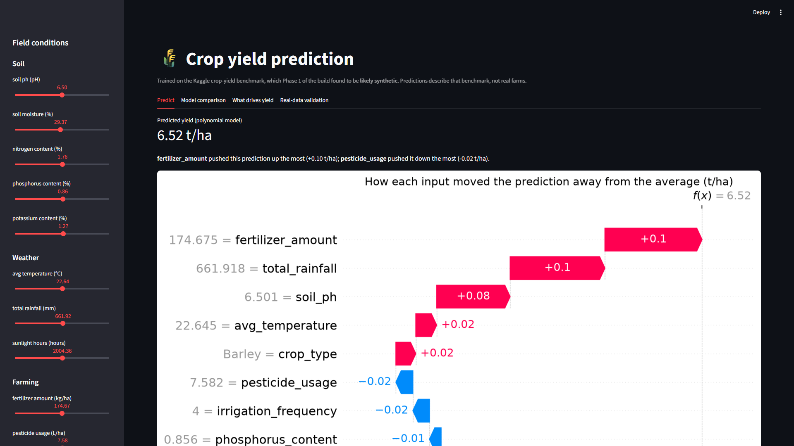
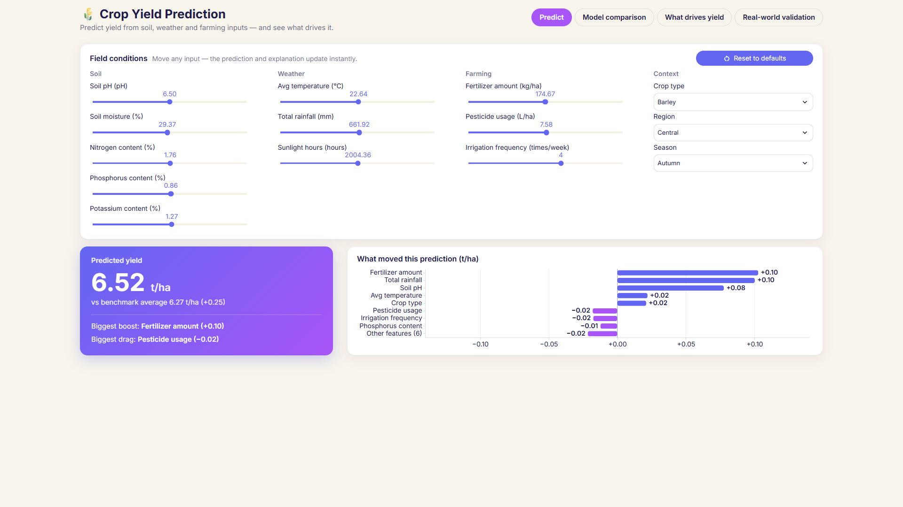
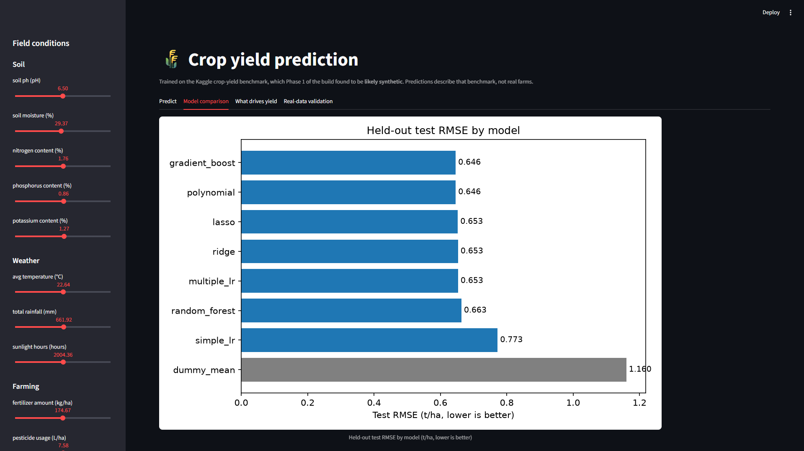
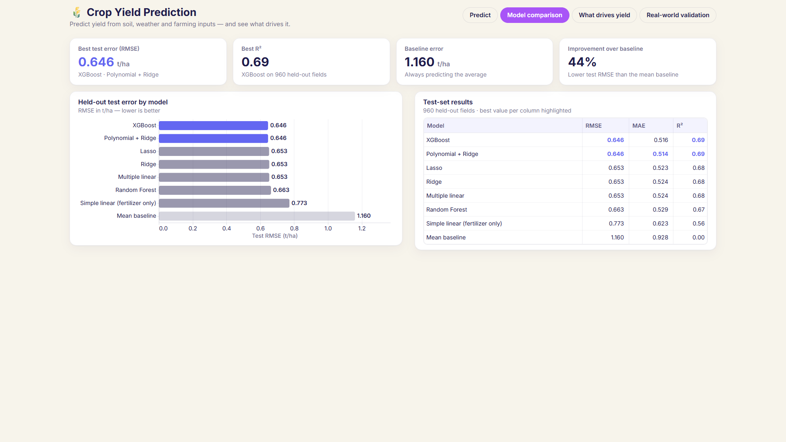
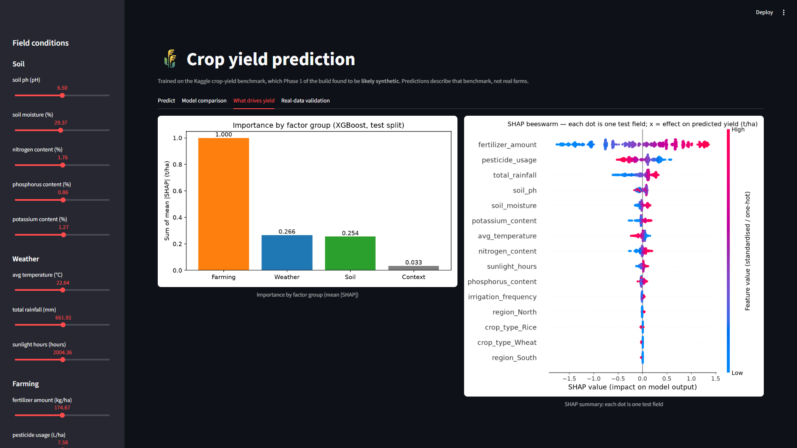
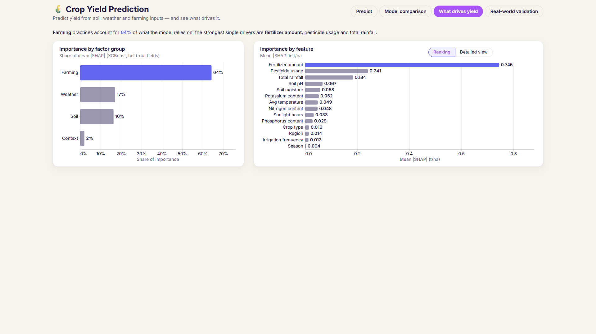
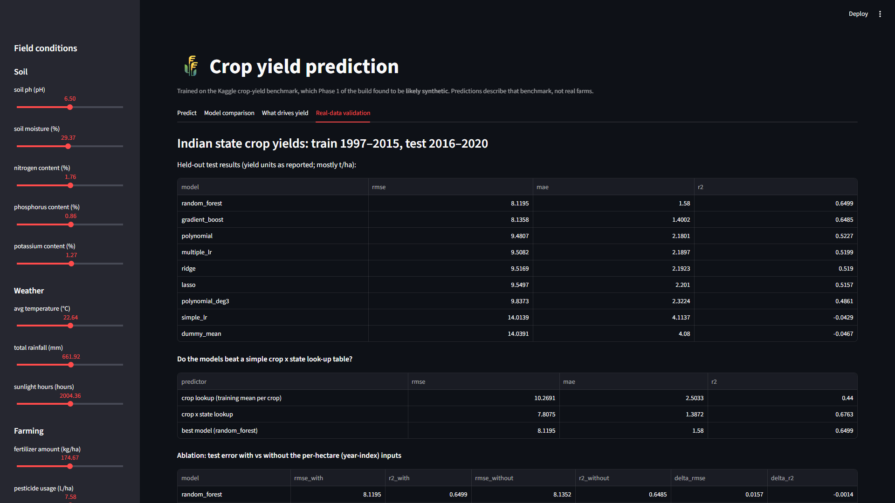
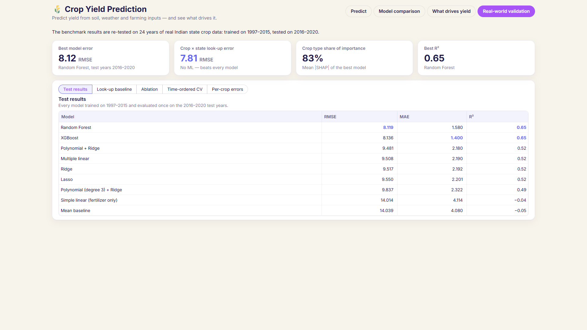

# UI redesign report: "Cyber Sand" single-screen dashboard

## 1. Summary

`app.py` was rebuilt from a sidebar-plus-stacked-figures layout into a single-screen dashboard in
the "Cyber Sand" palette.

**Theme and chrome**
- Warm oat canvas, white cards, navy structure, and indigo/purple accents used sparingly.
- The Inter font, loaded from Google Fonts with a system-ui fallback.
- Light mode is forced, and the Streamlit header, footer, sidebar and Deploy menu are hidden.

**Tabs**
- **Predict:** the inputs sit in a 4-column card. Below it are a gradient hero card with the
  prediction and an interactive "What moved this prediction" chart (top 8 contributions plus
  "other features").
- **Model comparison:** KPI cards, a bar chart and a results table.
- **What drives yield:** a plain-English takeaway, group shares and a per-feature ranking. The
  original SHAP beeswarm is kept behind a Ranking / Detailed view toggle.
- **Real-world validation:** KPI cards and five tables behind one pill selector.

**What did not change**
- No model or result changed. Every number the app shows is identical to the Phase 1 snapshot
  (21/21 checks).
- `src/`, `models/`, `results/figures/` and every existing table are byte-identical (SHA-256).
- The one approved data addition is a new table, `india_shap_shares.csv`, which lets the app show
  the 83 % crop-type share without recomputing SHAP.

**Fit to screen**
- All 4 tabs now fit without vertical scrolling at **both 1920×1080 and 1366×768**, down from
  6–212 % overflow before.
- No text is below 14 px, and no colour outside the palette is used in the page UI.
- Start-up: the server is ready in **1.3 s**, and the first full render takes **4.3 s**.

---

## 2. Before / after screenshots (1920×1080, 100 % zoom)

All screenshots were taken with headless Chrome at an exact 1920×1080 viewport; the 1366×768
versions are also in `docs/screenshots/`.

| Tab | Before | After |
|---|---|---|
| Predict |  |  |
| Model comparison |  |  |
| What drives yield |  |  |
| Real-world validation (was "Real-data validation") |  |  |

The "before" screenshots render dark because the old app followed the system theme. The new
`config.toml` locks the app to light mode.

---

## 3. Scroll measurements

Streamlit 1.64 scrolls an inner container, `section[data-testid="stMain"]`, not the document. So
`document.documentElement.scrollHeight` always equals `innerHeight` (1080 = 1080, 768 = 768, before
and after) and cannot show overflow. The table therefore reports the real scroll container:
`stMain.scrollHeight` / `stMain.clientHeight`. All values were measured with the same headless-Chrome
tool.

| Tab | 1920×1080 before | 1920×1080 after | 1366×768 before | 1366×768 after |
|---|---|---|---|---|
| Predict | 1811 / 1080 (+68 %) | **1080 / 1080 (0 %)** | 1341 / 768 (+75 %) | **768 / 768 (0 %)** |
| Model comparison | 1624 / 1080 (+50 %) | **1080 / 1080 (0 %)** | 1440 / 768 (+88 %) | **768 / 768 (0 %)** |
| What drives yield | 1148 / 1080 (+6 %) | **1080 / 1080 (0 %)** | 889 / 768 (+16 %) | **768 / 768 (0 %)** |
| Real-world validation | 2396 / 1080 (+122 %) | **1080 / 1080 (0 %)** | 2396 / 768 (+212 %) | **768 / 768 (0 %)** |

The old sidebar was an extra 1586 px scroll area at both sizes; it no longer exists.

**Other views measured at 1366×768:**
- All five Real-world validation tables (Test results, Look-up baseline, Ablation, Time-ordered
  CV, Per-crop errors): 768 / 768 each.
- The "Detailed view" beeswarm: 768 / 768.

**Targets:** at 1920×1080, every tab fits with no scrolling ✅. At 1366×768, Predict fits ✅, and
so does every other tab, so the ≤ 15 % allowance was not needed ✅.

---

## 4. Files changed or added

| File | Change |
|---|---|
| `app.py` | Rewritten as the dashboard. The model, explainer and data loading are unchanged (same cached `load_artifacts`, same Kernel SHAP explainer); presentation only. |
| `.streamlit/config.toml` | **New.** Palette, forced light mode, Inter font, `toolbarMode = "minimal"`, chart colours, radius. |
| `ui/__init__.py` | **New.** Package marker. |
| `ui/theme.py` | **New.** Palette constants, the CSS that `config.toml` cannot express (cards, pill tabs, hero, KPI cards, tables, hidden chrome, 14 px floor), and the `kpi_card` and `card_title` helpers. |
| `ui/charts.py` | **New.** One Altair theme helper, `style()`, used by every chart, plus the contribution chart and the ranked bar chart. |
| `notebooks/04_india.ipynb` | One save line in the SHAP cell (writes `india_shap_shares.csv`), then notebook 04 re-executed. *Approved by you in Phase 1.* It re-ran with 0 errors, and all its figures and tables are byte-identical. |
| `results/tables/india_shap_shares.csv` | **New.** India mean \|SHAP\| and share per feature (Crop 0.8337, the 83 % KPI). *Approved.* |
| `docs/screenshots/*.png` | **New.** 16 screenshots: before and after × 4 tabs × 2 sizes. |
| `UI_REDESIGN_REPORT.md` | **New.** This report. |
| `requirements.txt`, `requirements-lock.txt` | **Unchanged.** The charts use Altair 6.3.0, which ships with Streamlit, so Plotly was not added. |

---

## 5. Verification evidence

### 5.1 `python run.py check`

```text
[1/2] Lint (ruff)
All checks passed!
[2/2] Tests (pytest)
24 passed in 3.77s
All checks passed.
```

The new `ui/` package is not in `run.py`'s lint list, so it was checked separately each phase
(`python -m ruff check ui app.py` → All checks passed!).

### 5.2 Start-up time (under 10 s)

```text
$ python run.py app --no-browser   (timed until the health endpoint answers)
RESULT: http://localhost:8501/_stcore/health answered 'ok' 1.3s after `python run.py app --no-browser` started
$ first full app run in a cold process (AppTest)
first full run (imports + model + SHAP + all 4 tabs): 4.3s; exceptions: 0
```

### 5.3 Numbers unchanged vs the Phase 1 snapshot (21/21)

The snapshot was taken from the old app's data sources before any change. The check reads what
the new app renders: hero text, KPI cards, the chart data sent to the browser, and table data.

```text
[OK] hero prediction: shown '6.52' | snapshot '6.52'
[OK] benchmark average: shown '6.27' | snapshot '6.27'
[OK] contribution fertilizer_amount … phosphorus_content (8 values), and "other features" (sum): identical to full float precision
[OK] model table values (8 models × RMSE/MAE/R²): identical
[OK] KPI best test error 0.646 · best R² 0.69 · baseline error 1.160 · improvement 44%
[OK] feature importance values (14): identical
[OK] India test table values: identical
[OK] KPI India best model error 8.12 · look-up error 7.81 · best R² 0.65
21/21 checks identical to the Phase 1 snapshot
```

### 5.4 Interaction checks

```text
[default] prediction 6.52 t/ha | vs benchmark 6.27 | boost Fertilizer amount (+0.10) | drag Pesticide usage (−0.02)
[additivity] sum of chart bars = +0.2544 = 6.5199 − 6.2655 (unrounded prediction − benchmark average)
[slider] Fertilizer amount = 299.93 (max) -> 7.76 t/ha      | 50.05 (min) -> 4.70 t/ha
[slider] Irrigation frequency = 6 -> 6.58 t/ha              | 1 -> 6.54 t/ha   (changes of at most 0.06)
[pH] 4.5 -> −0.19 | 6.7 -> +0.08 | 8.499 (slider max) -> −0.16
[reset] fertilizer at max 7.76 -> Reset to defaults -> 6.52 t/ha; fertilizer back to 174.67
```

| Checklist item | Result |
|---|---|
| Fertilizer min → max changes the prediction 4.70 → 7.76 t/ha | ✅ |
| Irrigation changes it by at most 0.06 | ✅ (6.54–6.58) |
| pH 4.5 / 6.7 / 8.5 gives −0.19 / +0.08 / −0.16 | ✅ (8.5 is tested at the slider maximum, 8.499; see deviation 8) |
| The Reset button restores the defaults and the default prediction | ✅ (6.52 t/ha) |
| All 5 Real-world validation tables are reachable through the pills | ✅ (below) |

### 5.5 Real-world validation tables (all 5 through the pill selector)

```text
[Test results]     india_test.csv: 9 rows x 4 cols | numeric values identical to the CSV: True
[Look-up baseline] india_reference_baselines.csv: 3 rows x 4 cols | identical: True
[Ablation]         india_ablation.csv: 9 rows x 7 cols | identical: True
[Time-ordered CV]  india_cv.csv: 9 rows x 9 cols | identical: True (5 empty α cells for the tree models show as "—")
[Per-crop errors]  india_per_crop_rmse.csv: 10 rows x 7 cols | identical: True
```

Each table has readable headers (e.g. "CV RMSE (sd)", "RMSE / mean yield", "Median |error|") and
a one-sentence caption. Numbers are rounded to 3 decimals (R² to 2), and the best value per metric
column is in indigo. "Best" is judged at the displayed precision, so values that look tied are
highlighted together.

### 5.6 Design audit (programmatic, every tab at both sizes)

A script walked every visible element's computed `color`, `background-color` and `border-color`,
and checked every text node's `font-size`:

```text
1366x768 and 1920x1080 — Predict / Model comparison / What drives yield / Real-world validation:
  fit 768/768 and 1080/1080 · offPalette: none · belowFloor (<14 px): none
```

### 5.7 SHA-256: nothing in `src/`, `notebooks/`, `results/` or `models/` changed (except as approved)

```text
$ sha256sum -c ui_baseline.sha256   (72 files: src, notebooks, results, models, run.py, start.bat, app.py, README.md)
app.py: FAILED                     <- the redesign (intended)
notebooks/04_india.ipynb: FAILED   <- the approved one-line save of india_shap_shares.csv
files unchanged: 70 of 72
new files in those folders:
  + results/tables/india_shap_shares.csv   <- approved
```

All of `src/` and `models/`, every file in `results/figures/`, and every other table are
byte-identical. `README.md` is unchanged, and nothing was committed (`git rev-list --all --count`
→ 0).

---

## 6. Design review: what was found and fixed

These came from critically reviewing full-resolution screenshots at both sizes:

| Found | Fix |
|---|---|
| Predict tab overflowed by 25 % at 1366×768 | Tab pills moved into the header row; the inputs card header is one line; the chart axis title that repeated "(t/ha)" was removed; padding tightened. The Predict tab went from 963 px to 768 px. |
| Tightening the slider labels made values overlap their labels | Reverted; I took the space from other places instead |
| The contribution chart was sorted alphabetically, and its y-axis labels were clipped | An explicit magnitude order, and autosize `fit` with padding |
| Bars touched at compact heights | Band-relative bar sizes with 30 % padding between rows |
| The hero card was shorter than the chart card | The hero fills its column (`height="stretch"`) |
| Tables drew their cells in the canvas beige, with raw headers | `st.table` (white HTML) with the columns renamed on the data |
| Tie highlighting looked arbitrary (only one of two "0.646" values was highlighted), and "-0.00" appeared | Best value judged at the displayed precision; values that round to zero show as 0.00; typographic minus signs |
| A stray indigo underline sat under the active tab pill | The React-Aria selection indicator is hidden |
| KPI cards had uneven heights | A minimum height and shorter notes |
| Active states were inconsistent (tabs purple, selectors indigo) | Selectors now use the secondary accent, as the tabs do |
| 13.1 px text in the selector labels, slider readouts and Reset button | Raised to 14 px |
| The hover toolbar background was off-palette | Toolbars hidden, except on the beeswarm image (kept for enlarging it), with a white background |
| The group chart's axis was 0.00–0.70 while its labels were in % | Percent axis; fewer ticks on all charts so labels never collide |
| The takeaway line used indigo three times | Only the key number (64 %) keeps the accent |

**Final checklist:**
- ✅ Only palette colours and allowed tints are used (checked programmatically).
- ✅ Accents are rare: one indigo highlight per chart, one accent KPI per tab, and the purple
  active pill.
- ✅ Cards are consistent: 16 px radius, the same border, shadow and spacing.
- ✅ No text is below 14 px, and nothing is truncated or overlapping.
- ✅ Charts have readable labels, no clipped axes, and values on the bars.
- ✅ Visual hierarchy: the most important number is the largest element on each tab (the 52 px
  hero; an indigo KPI).
- ✅ No leftover Streamlit chrome or grey default styling.
- ✅ "Synthetic" doesn't appear in the header or on the Predict tab. In fact it appears nowhere in
  the app (AppTest string check).

---

## 7. Deviations

1. **Reference default is 6.52 t/ha, not 6.40.** The brief's 6.40 did not match the app, which
   has shown 6.5199 → 6.52 in every verification. You confirmed 6.52 in Phase 1.
2. **83 % crop share.** It wasn't saved anywhere, and recomputing it at start-up takes ~70 s. With
   your approval, notebook 04 now saves `india_shap_shares.csv`.
3. **Altair instead of Plotly.** Altair ships with Streamlit, so no dependency was added.
4. **`st.table` instead of `st.dataframe`.** `st.dataframe` draws on a canvas using the theme
   background (beige), which CSS cannot restyle to white. The tables are small (≤ 10 rows), so a
   static table loses nothing.
5. **KPI cards are custom HTML, not `st.metric`.** `st.metric` deltas are red/green, which is
   outside the palette.
6. **The tab pills sit in the header row (right-aligned), not in their own row.** This saves
   ~45 px, which the Predict tab needed to fit at 1366×768.
7. **The beeswarm keeps its original red/blue SHAP colours.** It's the existing PNG behind the
   "Detailed view" toggle, as the brief asked, and `results/figures/` must not change. Its fullscreen
   button is kept, because the original figure's own text is small; the card caption says
   "hover to enlarge".
8. **pH 8.5 is tested at 8.499.** The slider's range is the training range (4.50–8.4989), so 8.5
   is not reachable in the UI. The contribution at the maximum is −0.1555 → −0.16.
9. **The explanation chart is compact (176 px),** sized for the 1366×768 no-scroll target.
   Streamlit gets no viewport size on the server, so on 1920×1080 the page stays top-aligned, with
   spare canvas below rather than taller charts.
10. **`ui/` is not in `run.py check`'s lint list.** It was linted separately every phase. Adding it
    means editing `run.py`, which was outside the files allowed to change.
11. **`README.md` §7 still describes the old app** (the sidebar, a "Real-data validation" tab, a
    matplotlib waterfall). The README was outside this change's scope, so it's listed here as a
    follow-up.
12. **Development used a separate headless server on port 8502,** so your own instance on 8501 was
    never touched. Temporary tooling (screenshot driver, check scripts, an isolated Chrome profile)
    lived in the session's scratch folder. Nothing outside the project directory was modified.
