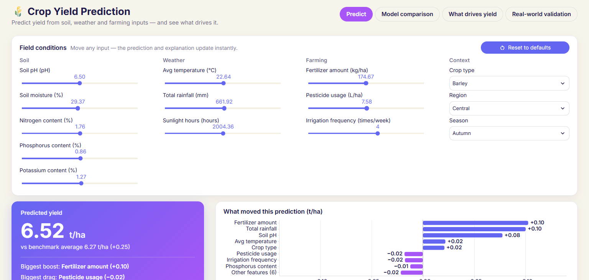
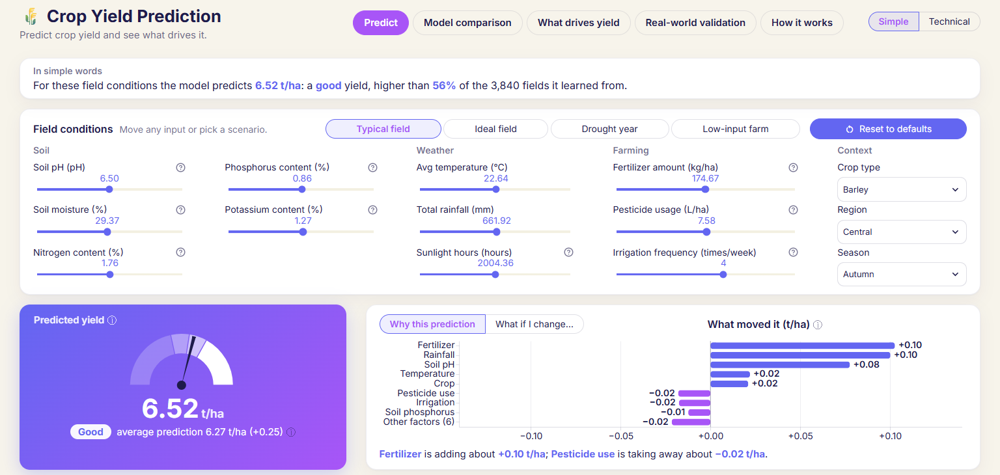
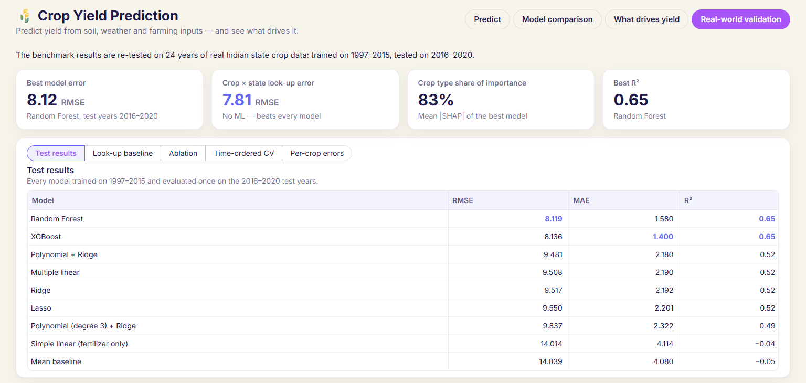
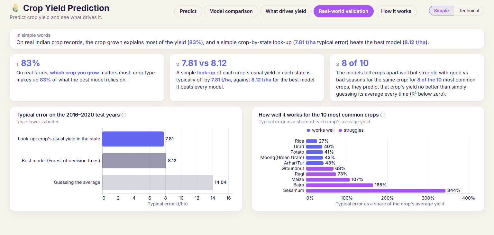
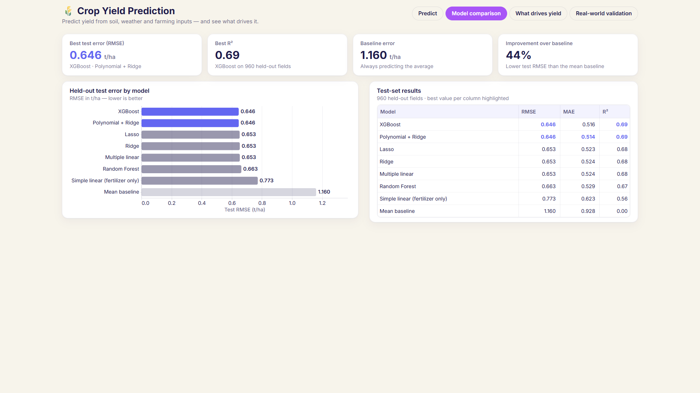
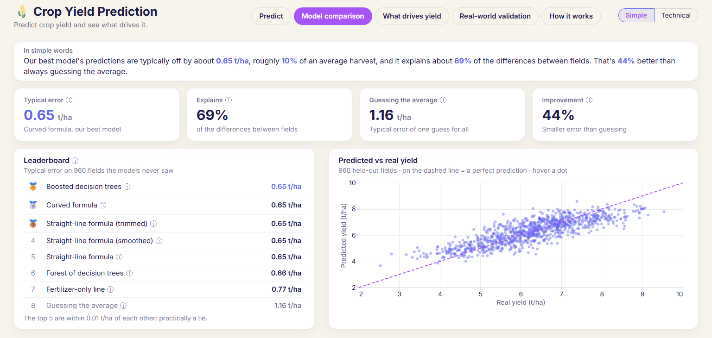

# Dashboard v2: Simple / Technical modes

**Goal:** make the dashboard understandable to a non-technical reader through plain language, interactive graphs and a Simple / Technical switch. Every number stays accurate, and the no-scroll layout is kept.

**Scope:** UI only. The files changed are `app.py`, `ui/theme.py` and `ui/charts.py`; the new files are `ui/plain.py`, `tests/test_plain.py` and the `docs/screenshots/v1_*` and `v2_*` images, plus the README (§7, §8 tree, §10 test count) and this report. `src/`, `notebooks/`, `results/` and `models/` are byte-identical to their state before the work (SHA-256, 69 files). Nothing was committed.

## 1. Summary

| | Result |
|---|---|
| Modes | **Simple** (default) and **Technical**, switched from the header. The choice is kept in `st.session_state["mode"]`, so it persists across tabs. |
| Plain language | Every tab opens with an **"In simple words"** card (1–2 sentences, key numbers in indigo `#6366F1`). Every sentence is built by a function in `ui/plain.py` from the model, `results/tables/` or `data/processed/`. None is hard-coded. |
| Tooltips | Technical terms carry an ⓘ in both modes: 20 on the default Simple screens and 14 in Technical mode, plus 9 slider help icons in both. |
| New graphs (Simple) | Yield gauge, what-if curve, leaderboard, predicted-vs-real scatter (960 points), factor-group donut, response curves, look-up vs model bars, per-crop verdict bars, "How it works" flow. |
| New tab | **How it works**, the same in both modes. |
| Technical mode | Every number is identical to the pre-change snapshot (21/21), and all 5 India tables are identical to their CSVs. |
| Fit | 48 states (every tab and sub-view, both modes) × 3 viewports: no vertical scroll anywhere, smallest text 14 px, tab pills on one row. |
| Speed | Server up in about 1.2 s; first full render 4.5–5.4 s; every interaction re-renders in 0.54–0.92 s. |
| Checks | `python run.py check`: ruff clean, **31 passed** (24 existing + 7 new). |

## 2. Phase 1 audit: technical terms, plain replacement, tooltip

| Shown in the app | Plain replacement (Simple mode) | ⓘ tooltip (both modes) |
|---|---|---|
| t/ha | "t/ha" kept, explained | Tonnes of harvest per hectare; a hectare is 10,000 m², about 1.4 football pitches. |
| Benchmark average (SHAP base value) | "average prediction" | The model's average prediction over the fields it learned from: the starting point before this field's own conditions are counted. |
| What moved this prediction (SHAP values) | "Why this prediction" / "What moved it" | How much each factor pushes this prediction above (+) or below (−) the average prediction, in t/ha (SHAP values). |
| RMSE / "Best test error (RMSE)" | "Typical error" | The typical size of a prediction's miss, in t/ha. Big misses count extra. Lower is better. |
| MAE | (Technical only) | The average size of a miss, in t/ha. |
| R² | "Explains X%" | The share of the differences in yield the model accounts for (1 = all, 0 = no better than guessing the average, below 0 = worse). |
| Baseline / Mean baseline | "Guessing the average" | A 'model' that predicts the same average yield every time. Any useful model has to beat it. |
| Improvement over baseline | "Improvement" | How much smaller the best model's typical error is than guessing the average. |
| Held-out / test set | "fields the models never saw" | Fields kept aside while the models were built and used once, at the end, for the final score. |
| Model names (XGBoost, Polynomial + Ridge, Lasso, Ridge, Multiple linear, Random Forest, Simple linear, Mean baseline) | Boosted decision trees, Curved formula, Straight-line formula (trimmed / smoothed / plain), Forest of decision trees, Fertilizer-only line, Guessing the average | "Technical name: …" on each leaderboard row |
| Mean \|SHAP\|, importance share | "Share of what the model relies on" | SHAP splits each prediction into pushes from each factor; the average size of those pushes ranks how much the model relies on each factor. |
| Beeswarm ("Detailed view") | (Technical only) | Each dot is one field: position = how much the factor pushed the prediction; colour = high or low value. |
| Partial dependence | "How yield responds to each factor" | The average prediction over 300 real training fields as one factor is swept; it shows what the model learned, not cause and effect. |
| Crop × state look-up | "Look-up: crop's usual yield in the state" | No machine learning: predict each crop's average yield in that state over the training years. |
| Ablation, Δ RMSE / Δ R² | (Technical only) | Re-run every model without the fertilizer and pesticide columns to see how much they help (Δ = change). |
| Time-ordered CV, sd | (Technical only) | Cross-validation where every check scores the model only on later years; sd = spread across the checks. |
| RMSE / mean yield | "Typical error as a share of the crop's average yield" | Under 50% is labelled "works well". |
| Soil pH, N / P / K content, sunlight hours, kg/ha, L/ha, irrigation frequency | Chart names: Soil pH, Soil nitrogen, Soil phosphorus, Soil potassium, Sunshine, Fertilizer, Pesticide use, Irrigation | Slider help: acidity scale, nutrient share in %, per-hectare units, waterings per week. |

The glossary on **How it works** repeats RMSE, R², SHAP, cross-validation and baseline in plain words.

## 3. Layout fixes (Phase 1)

- **Soil spans double width** with its 5 sliders split 3 + 2, so every input group is at most 3 rows tall. Columns are `[2, 1, 1.15, 0.85]`; the wider Farming column keeps "Irrigation frequency (times/week)" on one line at 1366 px.
- **Model comparison:** the chart and table cards use `height="stretch"`, so they are the same height. The same applies to the leaderboard and scatter cards.
- **1536×730** added as a test viewport. The v1 dashboard already overflowed there on Predict (4%, 31 px; `docs/screenshots/v1_predict_1536x730.png`).
- **Spacing:** top padding went from 0.9rem to 0.6rem and the block gap from 0.75rem to 0.65rem. Table rows went from 6 px to 4 px padding.
- **India table card:** the title that repeated the selected pill was removed; the caption now carries the ⓘ.

## 4. Before / after

| | Before (v1) | After (v2, Simple) |
|---|---|---|
| Predict |  |  |
| Real-world validation |  |  |
| Model comparison |  |  |

Other v2 screenshots:
- **Simple mode:** `v2_simple_predict_what_if_i_change_1536x730.png`, `v2_simple_what_drives_yield_1536x730.png`, `v2_simple_how_it_works_1536x730.png`, `v2_simple_predict_1920x1080.png`.
- **Technical mode:** `v2_technical_predict_1536x730.png`, `v2_technical_model_comparison_1536x730.png`, `v2_technical_real_world_validation_test_results_1536x730.png`.

## 5. Sentence-to-number verification (default inputs)

| Sentence (as rendered) | Source number |
|---|---|
| **Predict:** "the model predicts **6.52 t/ha**" | `model.predict` on the defaults = 6.5199 |
| "a **good** yield" | 6.5199 lies between the training-yield median 6.2911 and upper quartile 7.0944 |
| "higher than **56%** of the 3,840 fields it learned from" | 2,178 of 3,840 training yields are below 6.5199 = 56.7%. The share is **rounded down**, so it never says "100%" for 99.6% (the Ideal preset). |
| Gauge bands | Training yields: min 2.34, quartiles 5.45 / 6.29 / 7.09, max 9.54 |
| "average prediction 6.27 t/ha (+0.25)" | SHAP base value 6.2655 |
| "**Fertilizer** is adding about **+0.10 t/ha**; **Pesticide use** is taking away about **−0.02 t/ha**" | SHAP contributions +0.1027 / −0.0180 (the same values as the Technical chart) |
| "Soil pH: predicted yield peaks around **pH 6.6**" | What-if curve (40 points, 4.50–8.50) is highest at pH 6.551 |
| **Model comparison:** "typically off by about **0.65 t/ha**" | RMSE of the saved best model (polynomial) = 0.6462 |
| "roughly **10%** of an average harvest" | 0.6462 / mean yield of the 960 test fields 6.2819 = 10.3% |
| "explains about **69%** of the differences" | R² = 0.6898 |
| "**44%** better than always guessing the average" | 1 − 0.6462 / 1.1604 = 44.3% |
| "The top 5 are within 0.01 t/ha of each other" | 0.6461, 0.6462, 0.6526, 0.6533, 0.6533; the next is 0.6635 (+0.017) |
| Scatter "960 held-out fields" | `len(kaggle_test.parquet)` = 960; points = `best_overall.joblib` predictions |
| **What drives yield:** "**Farming practices** matter most (**64%** …)" | Farming share of mean \|SHAP\| = 0.6434 (Weather 0.1713, Soil 0.1638, Context 0.0215) |
| "fertilizer, then pesticide use … and rainfall" | Mean \|SHAP\| ranks 1–3: 0.7455, 0.2413, 0.1843 |
| "(more pesticide use is associated with lower yield)" | Spearman ρ(pesticide, yield) = −0.231 (`feature_signal.csv`); fertilizer +0.779 and rainfall +0.182 get no note |
| "Fertilizer: … rises across the whole range (**+3.05 t/ha** …)" | Response curve 4.547 → 7.599 |
| "Rainfall: … rises, then levels off above about **805 mm**" | 90% of the curve's rise is reached at 805 mm |
| **Real-world:** "the crop grown explains most of the yield (**83%**)" | `india_shap_shares.csv` Crop share = 0.8337 |
| "look-up (**7.81 t/ha** …) beats the best model (**8.12 t/ha**)" / "It beats every model." | Crop × state look-up RMSE 7.8075 < the lowest model RMSE, 8.1195 (Random Forest) |
| "**8 of the 10** most common crops … no better than guessing its average (R² below zero)" | Per-crop R² < 0: Maize, Urad, Moong, Groundnut, Sesamum (−0.001), Bajra (−0.002), Arhar/Tur, Ragi |
| "works well" / "struggles" bars | Relative RMSE < 0.5: Rice, Urad, Potato, Moong, Arhar/Tur work well; the other 5 struggle |
| **How it works:** 3,840 learned / 960 tested / 4,800 fields / 14 details | Train and test parquet row counts; `len(config.FEATURES)` |
| "Train 8 models", "5-fold", "20%" | Rows in `test_results.csv`; `config.CV_FOLDS`; `config.TEST_SIZE` |
| "0.65 t/ha typical error", "0.75 t/ha average push from fertilizer" | RMSE 0.6462; mean \|SHAP\| of fertilizer 0.7455 |

**Honesty checks:**
- No sentence makes a causal claim. They use "the model predicts", "predicted yield rises", "is associated with", and "shows what the model learned, not cause and effect".
- The Ideal preset is described as "values the model favours", not as advice.

## 6. Scenario presets (how they're derived; also documented in `preset_values`)

Crop, region and season always stay at the Typical defaults (Barley, Central, Autumn).

| Preset | Derivation | Prediction |
|---|---|---|
| Typical field | Training medians (= Reset) | 6.52 |
| Ideal field | Each numeric input at the argmax of its response curve (average prediction over 300 training fields): pH 6.55, moisture 50%, N 3.0, P 1.5, K 2.0, 13.2 °C, 1,143 mm, 2,999 h, fertilizer 300, pesticide 0, irrigation 6 | 9.15 |
| Drought year | Rainfall and soil moisture at their 10th percentile (218 mm, 14.0%); everything else Typical | 5.99 |
| Low-input farm | Fertilizer, pesticide and irrigation at their 10th percentile (75.2 kg/ha, 1.55 L/ha, 1 time/week); everything else Typical | 5.51 |

Moving any input by hand clears the preset highlight; Reset restores "Typical field".

## 7. Fit measurements (`section[data-testid="stMain"]`, headless Chrome)

No state scrolls: `scrollHeight == clientHeight`. Every text node is at least 14 px, and the tab pills sit on one row. Slack is the free space below the lowest element; the smallest slack is shown per tab.

| Tab / state | 1920×1080 | 1366×768 | 1536×730 |
|---|---|---|---|
| Simple · Predict (Why / What-if) | 354 / 359 | 42 / 47 | 4 / 9 |
| Simple · Model comparison | 366 | 54 | 16 |
| Simple · What drives yield | 512 | 177 | 162 |
| Simple · Real-world validation | 419 | 62 | 69 |
| How it works (both modes) | 463 | 92 | 113 |
| Technical · Predict | 375 | 63 | 25 |
| Technical · Model comparison | 379 | 67 | 29 |
| Technical · What drives yield (Ranking / Detailed) | 502 / 486 | 167 / 151 | 152 / 136 |
| Technical · Real-world (tallest pill: Per-crop errors) | 354 | 19 | 4 |

That is 48 states in total, and 0 fail. ⓘ tooltips were checked with real mouse hover: they render unclipped, and they open to the left near the right edge.

## 8. Verification

1. **`python run.py check`:** "Lint (ruff) All checks passed!" and "Tests (pytest) 31 passed". `tests/test_plain.py` asserts the rounded numbers in every generator, including 0.65 / 10% / 69% / 44%, 56% (and 99% rather than 100%), +0.10 / −0.02, 64% with the pesticide note, 83%, "7.81 vs 8.12", "8 of the 10", the tie note, and all curve shapes.
2. **Start-up (cold server, headless Chrome at 1536×730):** server up in 1.25 s and 1.19 s; first full render (headline, gauge and chart drawn) in 4.53 s and 5.36 s. No SHAP is computed for the scatter, the presets or the curves. The one explanation SHAP for the current inputs is unchanged from v1.
3. **Interaction timings (AppTest, full rerun including the per-input SHAP):**
   - fertilizer 0.69 s; Reset 0.76 s;
   - presets 0.60–0.92 s (Ideal's first use builds the 11 response curves);
   - what-if first use 0.54–0.63 s, cached 0.55 s;
   - response curve first use 0.62 s, cached 0.57 s;
   - mode switch 0.59 s.
4. **Technical mode vs the pre-change snapshot:** 21/21 identical. That covers the hero 6.52 and 6.27, all 9 contribution bars to full precision, the model table, 4 KPIs, feature importance, the India table and 3 India KPIs. All 5 India pills show values identical to their CSVs.
5. **Interactions:**
   - default 6.52; fertilizer at max 7.76;
   - Reset brings back 6.52 and a fertilizer value of 174.67;
   - all four presets load (6.52 / 9.15 / 5.99 / 5.51);
   - the soil-pH what-if curve peaks at 6.551 (inside 6–7.5);
   - the scatter has 960 points.
6. **SHA-256:** `src/`, `notebooks/`, `results/` and `models/` are unchanged (69 files).

## 9. Deviations and notes

- **Order of work:** the phases were implemented together and verified at the end, rather than stopping after each phase. The Phase 1 audit (§2) was drafted before any edit, and `python run.py check` passed after the code phases and again after the docs.
- **Rounding "higher than X%":** the share is rounded down (56.7% → 56%), so the sentence never overstates.
- **"Worse than guessing":** 2 of the 8 crops have R² of only −0.001 and −0.002, so the lesson says "no better than guessing" to stay accurate for all 8.
- **Integer inputs:** irrigation frequency is swept over its 6 whole numbers (1–6), not 40 points.
- **Slider labels:** these are identical in both modes. Changing a label per mode would reset the slider's value, so friendly names are used in charts and sentences instead, and the sliders gained help icons.
- **Existing SHAP at start-up:** the per-input SHAP explanation was already computed on first render in v1 and still is; it was not moved behind a click. Nothing new is computed with SHAP.
- **Technical-mode wording:** small changes that alter no number:
  - an ⓘ on terms;
  - the one-line takeaways replaced by the "In simple words" card;
  - "Test-set results" caption count taken from the data;
  - the India table card's title removed because the selected pill already names it.
- **Header subtitle:** shortened to "Predict crop yield and see what drives it." so five tab pills and the mode switch fit on one row at 1366 px.
- **Plain-language dependency on saved tables:** the pesticide note uses `feature_signal.csv` (Spearman ρ). If that table is missing, the note is simply left out.
